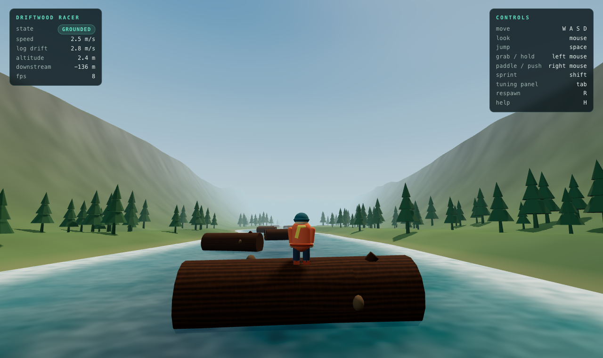
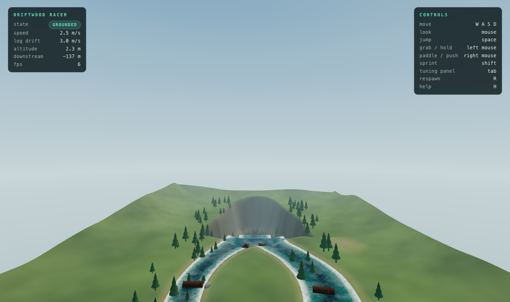
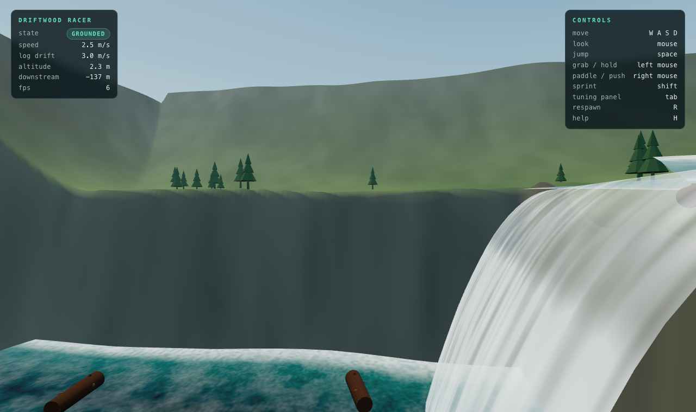

# Driftwood Racer

A physics sandbox about riding giant floating logs down a river.

You are a small person on a big piece of driftwood. The river moves you; you
decide where you end up. The character is a separate physical body from the
log - you can walk along it, jump off it, grab it when you fall in, paddle it
in a chosen direction, and transfer to another log in the current.

This repository is the **MVP v0.1** described in `writing-block.md`: one
continuous river, five sections, a fork, a waterfall, and a downstream finish.



*The fork: the river splits around a grassy island. Commit to a side before the
junction and the current takes you there.*



*The waterfall: a 24 m drop that the logs ride over in continuous simulation.*



---

## Running it

```bash
pnpm install
pnpm dev        # http://localhost:5173
```

Click the canvas to capture the mouse, then ride.

```bash
pnpm build      # type-check + production bundle into dist/
pnpm preview    # serve the production build
```

## Controls

| Action | Keyboard / mouse |
| --- | --- |
| Move | `W` `A` `S` `D` |
| Look | mouse |
| Jump | `Space` |
| Grab / hold on | left mouse button |
| Paddle / push the log | right mouse button |
| Sprint | `Shift` |
| Tuning panel | `Tab` |
| Flow field / buoyancy points / colliders / free camera | `F1` `F2` `F3` `F4` |
| Respawn at the top | `R` |
| Toggle the help panel | `H` |

---

## The river

Downstream is `+Z`. The course is one continuous body of water with no
loading screens, teleports or scripted sequences.

| Section | Where | What happens |
| --- | --- | --- |
| A - Gentle current | z -150 .. -70 | Wide, slow water. Learn to stand on a moving log. |
| B - River bend | z -70 .. 42 | The current picks up, boulders narrow the line. |
| C - The fork | z 42 .. 138 | The river splits: a wide slow **left** channel and a narrow fast **right** one, with an island between them. |
| D - Waterfall | z 138 .. 152 | A 24 m drop. The current accelerates to the lip and the water leaves as a falling sheet. |
| E - Recovery pool | z 152 .. 215 | A wide pool, then the finish. |

The fork is a real choice: the water in the left half of the channel turns
left and slows down, the water in the right half turns right and speeds up,
and the middle of the river is an island. Steer before the junction and the
current takes you where you aimed.

---

## How it works

The prototype is built around a handful of independent systems, each of which
can be understood (and tuned) on its own.

### WaterFlowSystem — `src/world/waterFlowSystem.ts`

There is no fluid simulation. The river is a set of **channels**: polylines
with a centreline, a half width, a surface height and a flow speed, resampled
through a Catmull-Rom spline so the water and the visible surface follow the
same curve. Everything asks the river the same question:

```ts
SampleWater(worldPosition) -> {
  present, surfaceY, depth,        // where the water is
  vx, vy, vz,                     // how fast it is moving there
  turbulence, flowSpeed, shoreDist
}
```

A separate *column* query (which ignores height) is used for immersion tests,
so a log floating with its centre above the waterline is still supported.

Forks blend the upstream channel into two branches across the junction, and
the waterfall is an explicit parabola: the water leaves the lip horizontally
at 6.4 m/s and falls under gravity, which is exactly the trajectory a log
riding the current follows.

### FloatingBody — `src/world/floatingBody.ts`

Buoyancy is solved **analytically** for the cylinder. The volume of the log
below the water surface is integrated over its cross section, and the
resulting force is applied at the true centre of buoyancy. That is what makes
a log right itself, pitch with the current and roll when the player shifts
their weight.

The wetted surface (a narrow strip along the underside) is computed from the
submerged cross section, and the drag from the current is applied at the log's
axis - which is what keeps the current from spinning every log like a wheel.

### PlayerController — `src/player/playerController.ts`

A hybrid controller: a kinematic capsule driven by Rapier's character
controller, but every interaction is force based.

* Moving platforms are carried **manually** (Rapier only carries kinematic
  bodies, and the logs are dynamic). The carry is horizontal only - following
  a rolling log's vertical motion exactly would push the character into it.
* The character's weight is transferred to the log by hand, so standing at
  one end really does tip the boat.
* Walking pushes back on the log with the equal and opposite impulse.
* A *grip* cancels slow drift relative to the log, so a wet log is slippery
  but a character who is not trying to move stays put. Past a limit (a steeply
  tilted log) the grip loses and they slide off.
* Jumping preserves the platform velocity at the launch point, so you keep
  the log's momentum when you leap.

States: `grounded`, `airborne`, `swimming`, `grabbing`, `climbing`. They are
derived from contact, immersion and grip conditions rather than scripted.

### GrabSystem / PaddleSystem — `src/player/`

* **Grab** is a distance constraint solved by hand so that both sides react:
  the character is pulled towards the object and the object receives the
  equal and opposite impulse. Holding the button while pushing towards the
  log reels the grip in, which is how you climb back aboard.
* **Paddle** applies an explicit stroke force. In the water it propels the
  character; standing on a log it pushes the *log*, which is how you steer a
  floating platform by paddling it.

### CameraController — `src/camera/cameraController.ts`

A third person orbit camera that follows the character, never the log. It
keeps a stable world-up orientation (a rolling log does not roll the camera),
smooths the follow, and pulls in with a sphere cast when geometry gets in the
way. `F4` switches to a free flying camera for inspecting the level.

### RiverLevel — `src/world/riverLevel.ts` and `terrainMesh.ts`

The level is data: channel definitions, rock placements, log spawns and tree
positions. The terrain is a single trimesh built on a regular grid that the
channels carve their bed into, so the shoreline you can see is the shoreline
the water system uses.

---

## Tuning and debug tools

`Tab` opens the physics panel. Every number in the tuning table
(`src/core/config.ts`) is live, and the panel can export/import the whole
table as JSON. Changes are saved to `localStorage`.

| Key | View |
| --- | --- |
| `F1` | Flow field - arrows showing where the current pushes |
| `F2` | Buoyancy sample points on every floating body |
| `F3` | Rapier's collider wireframe |
| `F4` | Free camera (`WASD` + `Q`/`E`, `Shift` to fly fast) |

---

## Tests

The prototype is validated against the acceptance criteria in
`writing-block.md`. The tests drive the real simulation headlessly (no
rendering) so they are fast and deterministic.

```bash
pnpm dev                # in one terminal
node tools/physics-test.mjs   # acceptance criteria T01 - T12
node tools/input-test.mjs     # controls + performance
```

`tools/physics-test.mjs` covers: logs stay buoyant and follow the current
(T01), no explosive physics (T01b), standing on a moving log (T02), jump
momentum (T03), the log reacting to the player (T04), grabbing (T05),
swimming (T06), recovering onto a log (T07), collisions (T08), choosing a
river branch (T09), the waterfall (T10), long-run stability (T11), reaching
the finish (T12) and a full descent from the top of the river to the bottom
(T12b).

`tools/screenshot.mjs` takes screenshots and can run a snippet inside the
page, which is handy for poking at the level:

```bash
node tools/screenshot.mjs --out shots/x.png --script "window.__driftwood.level.water.channelAt(0,0)"
```

---

## Notes and limitations

* The character controller is kinematic. It is stable and responsive, but the
  player is never pushed by physics - only the logs are.
* A perfect cylinder has no righting moment in roll, which turns every log
  into a spinning barrel. The logs therefore have an explicit righting
  moment (`log.righting`) - real driftwood is never a perfect cylinder - and
  the player can still tip a log by shifting their weight.
* The water is a flow field, not a fluid: there are no waves, no spray
  particles and no interaction between two bodies in the same water.
* The fall is a parabola plus a thin curtain, not a particle system. Objects
  fall over the lip in continuous simulation and splash into the pool.
* Only one character, no progression, no racing - the point of the MVP is to
  find out whether riding a physically simulated log is fun.

## Stack

* [Three.js](https://threejs.org) for rendering
* [Rapier](https://rapier.rs) (via `@dimforge/rapier3d-compat`) for physics
* [Vite](https://vitejs.dev) + TypeScript

No art assets: the bark, the water and the terrain colours are all generated
procedurally at load time.
